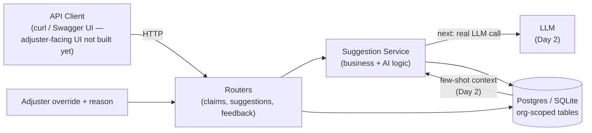

# Claims Feedback Loop (Agentic AI, In Progress)

A multi-tenant claims API built around a human-in-the-loop feedback pattern:
an AI suggests the next action on an insurance claim, a human adjuster (SME)
accepts or overrides that suggestion, and the override is captured and fed
back as context to improve future suggestions — rather than being discarded.

> **Status: in progress.** This is an active side project, not a finished
> product. The core loop is built and verified end-to-end: an LLM generates
> a suggestion, an adjuster override is captured with a reason, and that
> reason shows up as few-shot context in the *next* claim's prompt — plus a
> lightweight RAG endpoint for history summaries. The whole stack
> (backend + frontend + Postgres) runs with one `docker compose up`. What's
> still open is genuine test coverage and pagination — see
> [Future Improvements](#4-future-improvements).

## 1. Why I Built This

I wanted hands-on practice with a pattern that's increasingly common in AI
products: using a human expert's corrections as a live feedback signal,
instead of treating "the model was wrong" as a dead end. In an insurance
claims context specifically, an adjuster overriding an AI's suggested action
is valuable *data* — it's a signal about what the model is missing — and a
well-designed system should capture and reuse that signal, not just log it
and move on.

I also wanted to practice this with the discipline a real B2B SaaS product
needs: strict multi-tenant data isolation (every org's claims, adjusters,
and feedback history stay scoped to that org), and a clear boundary between
"HTTP plumbing" and "AI/business logic" so the AI piece can evolve
independently without destabilizing the API layer around it.

## 2. Design Decisions

**Service layer, not logic in the router.** `app/services/suggestion_service.py`
owns suggestion generation; `app/routers/suggestions.py` only parses the
request, calls the service, and shapes the response. This keeps prompt
construction, the LLM call, and (soon) retrieval of past feedback
unit-testable on their own, with no FastAPI app or HTTP layer required to
test them.

**Tenant scoping is enforced at the query level, everywhere.** Every claim,
adjuster, and feedback lookup is filtered by `org_id` — including a
composite index on `(org_id, status)` for the common query pattern — rather
than relying on an application-level check that's easy to forget on one
endpoint and not another.

**An explicit claim state machine.** Claims move through
`open → under_review → approved/denied` via a transition table
(`app/models.py`), and an invalid transition returns `409`, not a silent
no-op or a `500`.

**The feedback loop is structural, not a log table.** `POST
/suggestions/{id}/feedback` requires an `override_reason` whenever an
adjuster overrides a suggestion, and that reason is what Day 2's LLM
integration will pull as few-shot context for similar future claims — the
schema was designed around that reuse from the start, not bolted on later.

**Auth is explicitly stubbed, not faked as real.** `app/deps.py` reads org
identity from an `X-Org-Id` header with a comment flagging that this is a
stand-in for JWT/session auth — honest about what's a placeholder versus
what's production-shaped.

## 3. Architecture



Request flow: a client calls a router endpoint → the router validates the
request and delegates to the service layer → the service holds the
suggestion logic (currently rule-based, LLM next) and is the only layer
that talks to an LLM → every DB read/write, in both the router and the
service, is scoped by `org_id`. Adjuster feedback flows back in through the
same router layer and lands in a table `prompts.py` queries directly for
few-shot context on every subsequent suggestion for that org.

## 4. Future Improvements

- **Tests around tenant isolation and the state machine**, so a future
  refactor can't silently reintroduce a cross-tenant leak — the single
  highest-value thing left to add.
- **A real vector store for RAG** (e.g. pgvector/Chroma) if claim volume or
  note length ever outgrows the in-memory cosine-similarity approach in
  `app/rag/vectorstore.py` — not needed at this project's current scale.
- **Pagination + sorting on `GET /claims`**, written carefully enough not to
  reintroduce the exact tenant-scoping bug this project is partly meant to
  demonstrate awareness of.
- **A production-shaped Docker setup**: the current `Dockerfile`s run
  `uvicorn --reload` and the Vite dev server for local convenience (bind
  mounts, hot reload) — a real deployment would use a multi-stage build,
  serve the frontend as static assets behind nginx, and drop `--reload`.

## Search, RAG and the ReAct investigator

Needs Postgres with pgvector (`docker compose up` gives you both). On SQLite the app still runs, but search returns a 503 explaining why.

| What | Where |
|---|---|
| Chunk, embed and index claims (idempotent by content hash) | `app/rag/chunking.py`, `indexing.py` |
| pgvector HNSW + full text GIN, tenant filter inside the SQL | `app/rag/search.py`, migration `0002` |
| Hybrid search with Reciprocal Rank Fusion | `HYBRID_SQL` in `search.py` |
| Optional LLM reranking, validated, falls back to original order | `app/rag/rerank.py` |
| History summary that must cite sources, bad citations removed | `app/rag/retriever.py` |
| ReAct claim investigator (LangGraph, read only tools, step cap) | `app/agents/investigator.py` |
| Prompt injection handling for claim text | `app/safety.py` |
| Retrieval eval: recall@3, recall@5, MRR | `scripts/run_retrieval_eval.py` |

Endpoints: `GET /claims/search?q=&mode=hybrid|vector|keyword&rerank=`, `POST /claims/reindex`, `POST /claims/{id}/investigate`.

Run the app with real embeddings:

```bash
ollama pull nomic-embed-text
EMBEDDING_PROVIDER=ollama docker compose up --build
```

If you had the old alpine database volume, run `docker compose down -v` once, because the image changed.

Tests: `pytest` (158 tests). The Postgres tests create a `claims_test` database and skip if Postgres is not reachable. Set `TEST_DATABASE_URL` to change it.

Honest limits:
- The default `stub` embedder hashes words, so it matches wording, not meaning. Real quality needs Ollama.
- I have not yet recorded real retrieval numbers. Run the eval with Ollama and put the table here.
- The eval set is 30 synthetic claims and 20 queries. It shows the method differences, not production accuracy.

More on the Postgres side: `docs/pgvector-notes.md`.


## Folder structure

```
backend/
  Dockerfile                    # python:3.11-slim, uvicorn --reload
  requirements.txt
  app/
    main.py                      # FastAPI app, mounts routers
    database.py                   # engine/session setup
    deps.py                        # auth stub (org_id from header)
    models.py                     # SQLAlchemy models + claim state machine
    schemas.py                     # Pydantic request/response models
    routers/                       # thin HTTP layer — no business/AI logic
      claims.py
      suggestions.py
      feedback.py
      setup.py
    services/                      # orchestration — decides *what* to do
      suggestion_service.py         # builds prompt -> calls LLM -> validates
                                     # -> retries once -> falls back safely
    agents/                         # the LLM-facing pieces, each a separate
                                     # concern so any one of them can change
                                     # without touching the others
      llm_client.py                  # provider wrapper (stub or real Anthropic
                                      # call); the only file that imports an SDK
      prompts.py                     # builds the prompt, pulls recent org
                                      # overrides in as few-shot examples —
                                      # this is where the loop actually closes
      parsers.py                     # validates raw LLM text into a strict
                                      # Pydantic schema before anything trusts it
    rag/                            # lightweight retrieval for the
                                     # history-summary endpoint (see below)
      vectorstore.py                  # in-memory cosine-similarity store
      ingestion.py                    # loads an org's claim history into it
      retriever.py                    # retrieves + asks the LLM to summarize

frontend/
  Dockerfile                    # node:20-slim, Vite dev server
  src/                           # React + TS + Tailwind, shadcn-style components
                                 # (see Frontend section above)

docker-compose.yml              # wires backend + frontend + Postgres together
```

`app/`'s internal layout is unchanged by the Docker/folder work — adding
`backend/` and `frontend/` as top-level folders only moved where `app/`
lives, it didn't reorganize what's inside it.

**Why `services/` is separate from `agents/`:** `suggestion_service.py` is
the orchestrator — it decides the *flow* (build prompt, call LLM, validate,
retry once, fall back). `agents/` holds the pieces that flow calls, each
isolated so it can change independently: swapping LLM providers only
touches `llm_client.py`; changing what counts as good few-shot context only
touches `prompts.py`; tightening response validation only touches
`parsers.py`. None of this logic lives in the HTTP routers — a router's job
stays "parse the request, call a service, shape the response." This also
makes the whole pipeline unit-testable without spinning up FastAPI or
hitting an HTTP endpoint at all (see `tests/test_suggestion_service.py` in
PROMPTS.md's Day 2 prompt).

**Why `rag/` is separate from `agents/`:** the history-summary endpoint is
a different use case (retrieval + a summary for a human to read) from
suggestion generation (a decision an endpoint acts on), so it's kept in its
own module rather than overloading `agents/` with two unrelated jobs. It
still reuses `agents/llm_client.py` for the actual LLM call — no duplicate
provider-wrapping code.

## What's here

- **Multi-tenant schema**: `Organization` → `Adjuster`, `Claim`. Every claim
  query is scoped by `org_id` (see `app/routers/claims.py`), with a
  composite index (`org_id`, `status`) for the common query pattern.
- **Claim state machine**: `open → under_review → approved/denied`, invalid
  transitions return `409` (`app/models.py` has the transition table).
- **The feedback loop, end to end**:
  - `POST /claims/{id}/suggest` — generates an AI suggestion by calling an
    LLM (`app/agents/llm_client.py`; falls back to a deterministic offline
    stub when no API key is set, so the whole pipeline runs with zero
    setup). The prompt (`app/agents/prompts.py`) includes this org's most
    recent *overridden* suggestions as few-shot examples — a past human
    correction actually changes future suggestions, not just gets logged.
  - The raw LLM response is validated against a strict Pydantic schema
    (`app/agents/parsers.py`) before anything trusts it; a malformed
    response triggers one retry, then a safe rule-based fallback
    (`app/services/suggestion_service.py`) rather than a silent failure or
    a crash.
  - `POST /suggestions/{id}/feedback` — records whether a human adjuster
    accepted or overrode the suggestion, and why (required on override).
    This table is exactly what `prompts.py` queries to close the loop.
  - `GET /feedback/override-rate` — a rough "is the loop working" signal.
- **Lightweight RAG**: `GET /claims/{id}/history-summary` retrieves
  similar prior claims within the same org (`app/rag/`, in-memory cosine
  similarity — no vector DB, see the module docstrings for why that's the
  right size at this scale) and asks the LLM to summarize what they
  suggest. Informational only; nothing downstream auto-acts on it the way
  it does on `suggest`.
- **Auth stub**: `X-Org-Id` header stands in for a real JWT (see
  `app/deps.py`, with an explicit comment on why this isn't production-safe).

All of the above has been run end-to-end: a claim gets a suggestion, an
adjuster overrides it with a reason, and a *second* claim's prompt can be
shown to contain that override verbatim as a few-shot example — that's the
concrete proof the loop closes, not just that the pieces exist.

## Walkthrough

```bash
# 1. Create an org and adjuster
curl -s -X POST localhost:8000/organizations -H "Content-Type: application/json" \
  -d '{"name":"Acme Insurance"}'
curl -s -X POST localhost:8000/adjusters -H "Content-Type: application/json" \
  -d '{"org_id":"<ORG_ID>","name":"Jane SME","email":"jane@acme.com"}'

# 2. Create a claim (org_id in body must match X-Org-Id header)
curl -s -X POST localhost:8000/claims -H "Content-Type: application/json" \
  -H "X-Org-Id: <ORG_ID>" \
  -d '{"org_id":"<ORG_ID>","claimant_name":"John Doe","amount":3200,"history_notes":"Back injury, ongoing PT"}'

# 3. Get an AI suggestion for the claim
curl -s -X POST localhost:8000/claims/<CLAIM_ID>/suggest -H "X-Org-Id: <ORG_ID>"

# 4. Record the human's decision
curl -s -X POST localhost:8000/suggestions/<SUGGESTION_ID>/feedback \
  -H "Content-Type: application/json" -H "X-Org-Id: <ORG_ID>" \
  -d '{"adjuster_id":"<ADJUSTER_ID>","action_taken":"overridden","final_action":"denied","override_reason":"Missing documentation"}'

# 5. Check the override rate
curl -s localhost:8000/feedback/override-rate -H "X-Org-Id: <ORG_ID>"

# 6. Get a history summary for a new claim (lightweight RAG)
curl -s localhost:8000/claims/<NEW_CLAIM_ID>/history-summary -H "X-Org-Id: <ORG_ID>"
```

To use a real LLM instead of the offline stub, set `ANTHROPIC_API_KEY` in
your environment before starting the server — `backend/app/agents/llm_client.py`
picks that up automatically; no code change needed.

## Still open (see Future Improvements above)

- Real tests around tenant isolation and the state machine.
- Pagination + sorting on `GET /claims`, written carefully enough not to
  reintroduce a tenant-scoping regression.
- Hardening `docker-compose.yml` into a production-shaped multi-stage build
  (see Future Improvements) — today's setup is deliberately dev-oriented.
