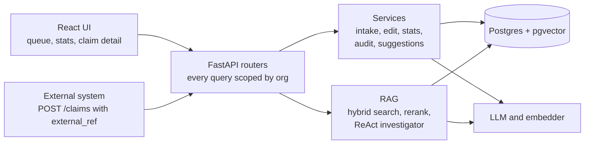
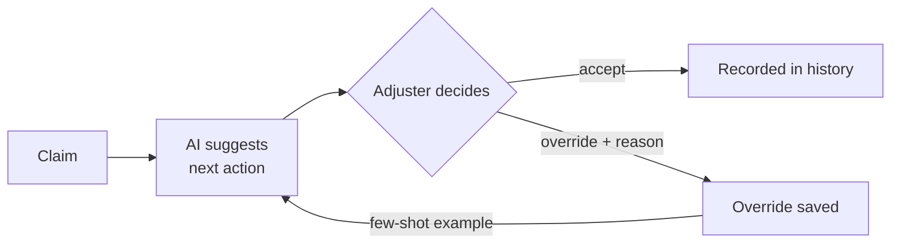
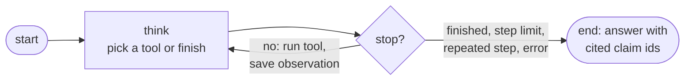
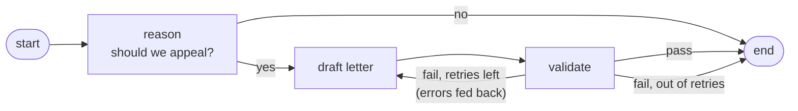
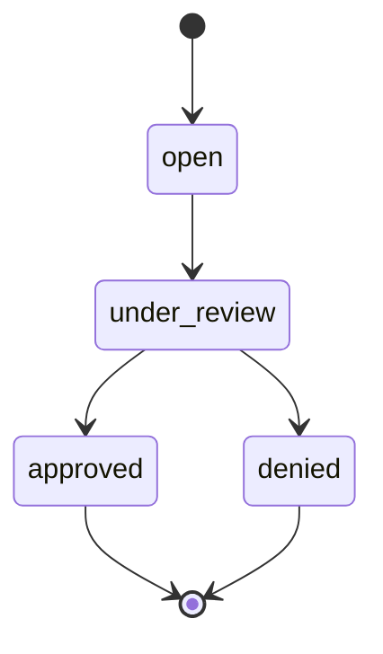

# Claims Feedback Loop (Agentic AI)

A multi-tenant insurance claims API built around a human-in-the-loop feedback
pattern. An AI suggests the next action on a claim, a human adjuster accepts
or overrides it, and every override is captured with a reason and fed back as
context for future suggestions instead of being discarded.

**Stack:** FastAPI, SQLAlchemy, Alembic, Postgres with pgvector, LangGraph,
React, TypeScript, Tailwind, Docker Compose. LLM and embeddings run through a
provider wrapper (Anthropic, Ollama, or an offline stub).

## What it does

- **Closes the feedback loop.** An override requires a reason, and the most
  recent overrides for that org are injected into the next prompt as few-shot
  examples. A human correction changes future suggestions.
- **Validates every LLM answer.** Raw output is parsed into a strict schema,
  retried once on failure, then replaced by a rule-based fallback. Nothing
  trusts unvalidated model text.
- **Searches claim history.** Hybrid search (pgvector vectors plus full text,
  merged with Reciprocal Rank Fusion) with optional LLM reranking and a
  history summary that must cite its sources.
- **Investigates a claim.** A read-only ReAct agent (LangGraph, capped steps)
  looks through similar claims and reports findings.
- **Supports the adjuster's workflow.** Review queue, stats cards (counts,
  approval rate, override rate), claim editing, and a full audit history.
- **Accepts claims from outside systems safely.** Idempotent intake by
  `external_ref`, so a retry never creates a duplicate.

## 3. Architecture

### The feedback loop

### LangGraph agents

Two LangGraph graphs drive the multi-step AI work. Each has a hard stop so it
can't loop forever.

**Claim investigator** (read-only ReAct loop, `agents/investigator.py`)

**Denial appeal drafter** (`agents/appeal_graph.py`)

### Claim lifecycle

Claims move `open → under_review → approved or denied`. An invalid move
returns `409`.

For the step-by-step flows (suggestion pipeline, search, editing, idempotent
intake), see [docs/architecture.md](docs/architecture.md).

## Design decisions

**Thin routers, logic in services.** Routers parse the request, call a
service and shape the response. Prompt building, the LLM call, validation and
fallback live in services and `agents/`, so they are testable without FastAPI.

**Tenant isolation at the query level.** Every claim, adjuster, suggestion and
feedback lookup filters by `org_id`, including inside the vector search SQL.
It is not a check that one endpoint can forget.

**An explicit state machine.** `open → under_review → approved/denied` uses a
transition table. An invalid move returns `409`, not a silent no-op or a `500`.

**The feedback loop is structural.** The schema requires `override_reason` on
an override because that field is the training signal. It was designed around
reuse, not added as a log table.

**Separate concerns for the AI pieces.** Swapping the LLM provider touches
only `llm_client.py`. Changing what counts as good few-shot context touches
only `prompts.py`. Tightening validation touches only `parsers.py`. RAG lives
in its own module because summarizing history is a different job from
generating a decision.

**Safe by default.** Claim text is treated as untrusted and screened for prompt
injection. LLM citations are checked and bad ones removed. A reranker failure
falls back to the original order. An indexing failure never fails an edit.

**Concurrency handled in the database.** A unique index on
`(org_id, external_ref)` lets one concurrent insert win while the others read
and return that row.

**Auth is an explicit stub.** `X-Org-Id` stands in for JWT or session auth,
and the code says so. It marks what is a placeholder and what is
production-shaped.

## What I learned

- **Feedback is data.** Designing the schema around reuse of human corrections
  matters more than the model call itself.
- **LLM output is untrusted input.** Validate, retry, then fall back, and
  never let a malformed answer reach the database or the user.
- **Hybrid retrieval beats either method alone.** Vector search matches
  meaning, full text matches exact terms, and rank fusion combines them
  without tuning score scales.
- **Multi-tenancy belongs in the query.** Putting the tenant filter in the SQL
  itself, and testing it, is safer than remembering it per endpoint.
- **Idempotency needs the database.** A check-then-insert has a race. A unique
  index plus re-reading on conflict does not.
- **Stale AI advice is a real bug.** Marking suggestions stale on edit and
  rejecting decisions on them prevents acting on outdated output.
- **Evaluation keeps retrieval honest.** A small eval set (recall@3, recall@5,
  MRR) shows which method actually helps.

## Testing

About 158 tests cover tenant isolation, the state machine, claim editing,
audit history, idempotent intake, stats and queue, search, reranking, the
investigator, prompt-injection handling and the feedback context. Postgres
tests create their own database and skip when Postgres isn't reachable.

## Honest limits

- The default `stub` embedder hashes words, so it matches wording, not
  meaning. Real quality needs Ollama embeddings.
- I haven't recorded real retrieval numbers yet. The eval set is 30 synthetic
  claims and 20 queries, so it shows method differences, not production accuracy.
- On SQLite the app runs, but search returns a 503 because pgvector is needed.
- The Docker setup is for development (hot reload, Vite dev server).

## Next steps

- Record retrieval eval results with Ollama embeddings.
- Real authentication in place of the header stub.
- A production Docker build: multi-stage, static frontend behind nginx.
- Cursor pagination if `GET /claims` outgrows limit and offset.

## Project layout

- `backend/app/routers/`: thin HTTP layer
- `backend/app/services/`: claim intake, editing, stats, review queue, audit, suggestions
- `backend/app/agents/`: LLM client, prompts, parsers, ReAct investigator
- `backend/app/rag/`: chunking, indexing, embeddings, hybrid search, rerank, retriever
- `backend/migrations/`: Alembic migrations (pgvector, audit, external_ref)
- `frontend/src/`: React UI (review queue, stats, claim detail, history, search)
- `docs/architecture.md`: detailed flow diagrams
- `docs/pgvector-notes.md`: notes on the Postgres side
