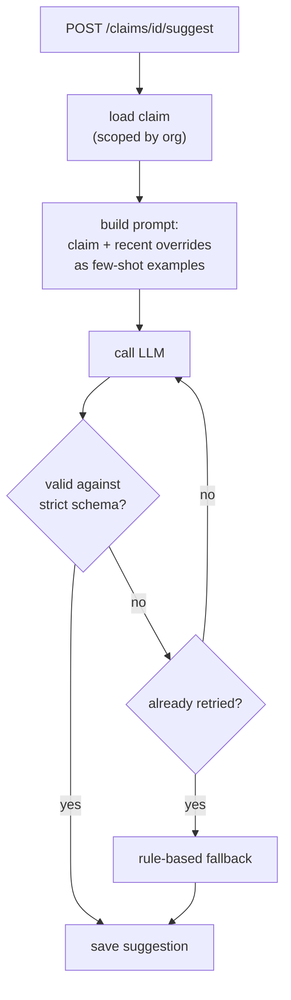
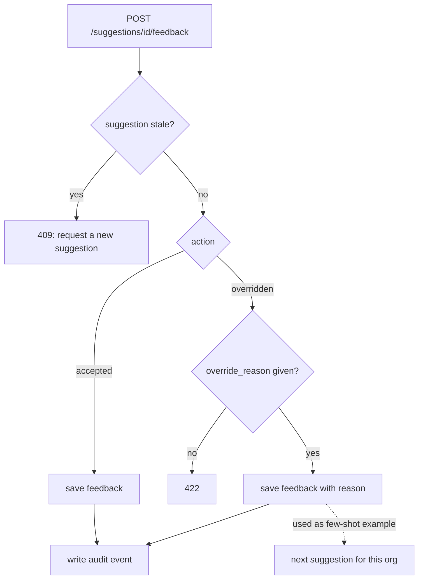
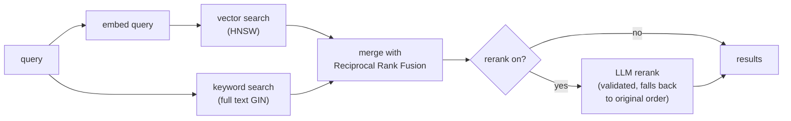
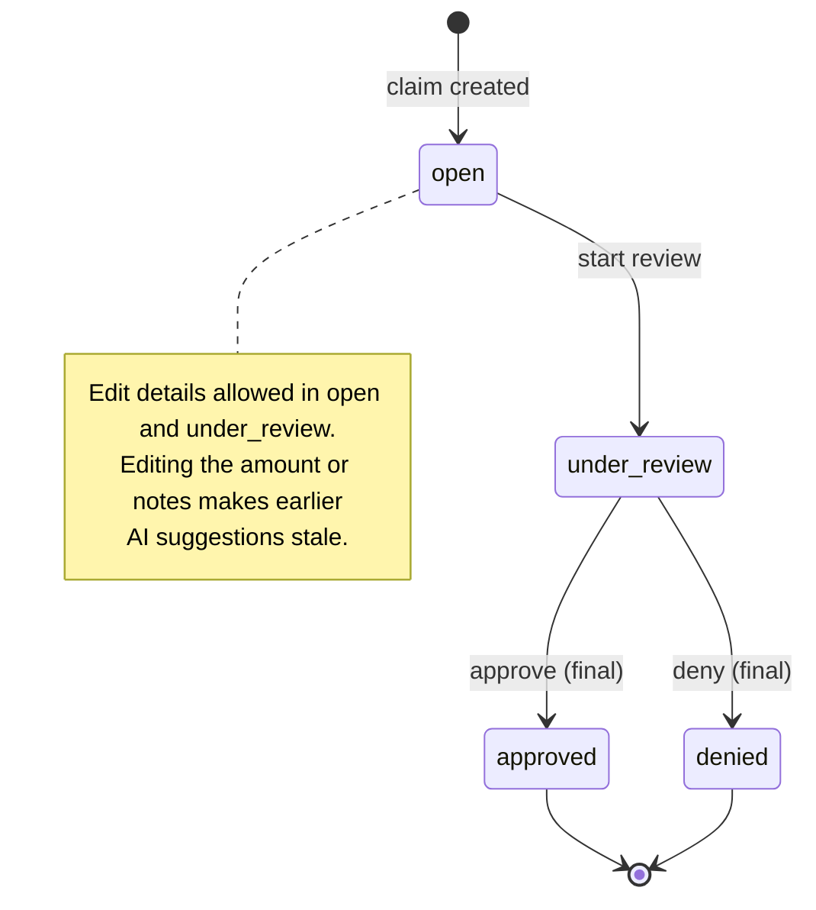
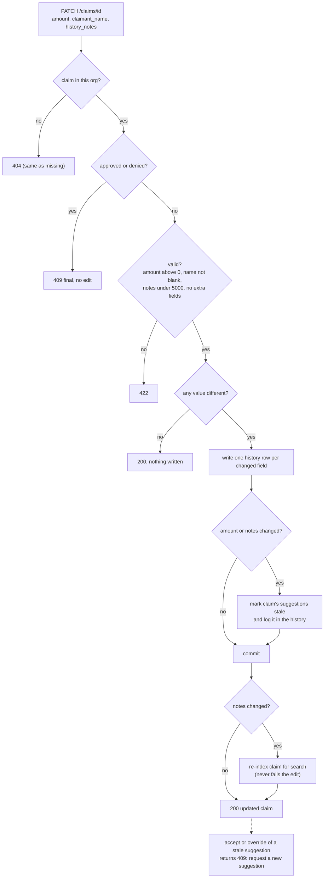
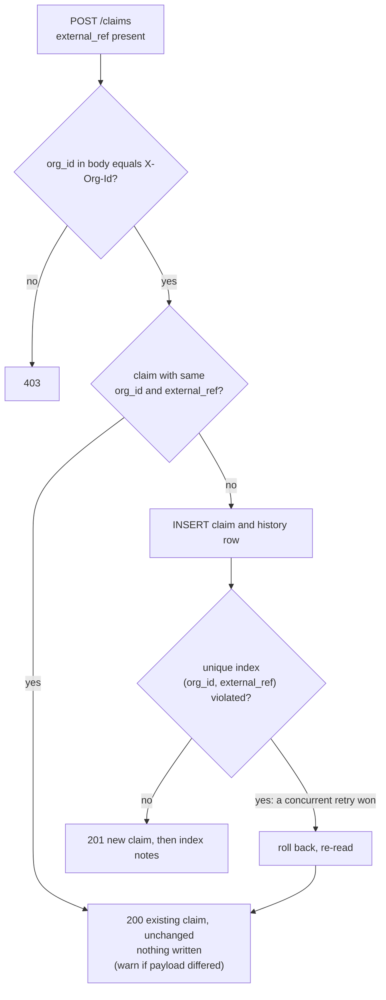

# Architecture details

Deeper flow diagrams for the claims feedback loop. The overview is in the
[README](../README.md).

## Generating a suggestion

The LLM is never trusted directly. Output is validated, retried once, then
replaced by a rule-based fallback.

## Recording the adjuster's decision

## Hybrid search

Tenant filtering happens inside the SQL, not after the fact.

## Claim lifecycle

Editing is allowed while a claim is open or under review.

## Editing a claim

Editing the amount or notes makes earlier AI suggestions stale, so an adjuster
can't act on advice that no longer matches the claim.

## Idempotent intake

